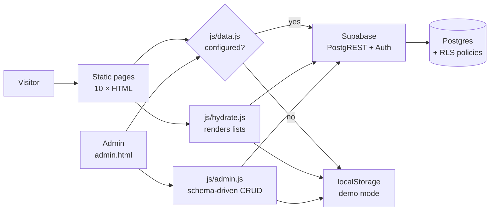

<div align="center">

# Zoepy Petshop Jogja

**High-energy editorial marketing site + Supabase-backed admin panel, for a real pet shop in Yogyakarta.**


</div>

---

## Overview

A production site for **Zoepy Petshop Jogja** — grooming, pet hotel, clinic and pet
supplies in Yogyakarta. Two halves that share one data layer:

- **Public site** — 10 pages with a kinetic, editorial look: oversized type, a
  scroll-velocity marquee, a pinned horizontal strip, a drag-to-scroll product rail and a
  before/after compare slider.
- **Admin panel** — email/password login, full CRUD over six tables, an incoming booking
  queue and site settings, protected by Supabase Auth and Row Level Security.

Every list on the public site reads from the database, so filling in the admin panel changes
the live pages. When Supabase is not configured the whole thing runs in **demo mode**
(localStorage) instead of breaking — see [Two modes](#two-modes).

## Screenshots

| Landing | Admin panel |
| --- | --- |
|  |  |

## Key Features

**Public site**

- Oversized kinetic type (Anton) with a masked line reveal, over an obsidian / acid-lime
  palette.
- **Lenis** smooth scrolling wired into **GSAP ScrollTrigger**: parallax media, staggered
  section entrances, a marquee whose speed follows scroll velocity, and a pinned horizontal
  strip.
- Custom cursor, magnetic buttons, 3D tilt on cards, rotating SVG badge.
- **Booking form** on two pages that writes to the `bookings` table.
- Real content in Indonesian for every page — no Lorem Ipsum anywhere.
- `prefers-reduced-motion` / `-transparency` respected; content is always readable if
  JavaScript fails.

**Admin panel**

- Supabase Auth login; every write is guarded by RLS, not by hiding a page.
- **Schema-driven CRUD** — one renderer for all tables. Adding a table means adding one entry
  to `RESOURCES` in `js/admin.js`; the list, form and validation are generated from it.
- Booking queue with a new-booking badge, live search, and inline edit/create modals.
- Site settings editor — address, phone, email, hours and the pricing plans.

**Engineering**

- One data layer (`js/data.js`) with the same API over Supabase or localStorage.
- Progressive enhancement: pages ship static markup and are *replaced* only when data loads.
- Pricing plans live in `site_settings` as JSONB, so adding a plan needs no migration.
- Generator scripts build the repeated page chrome from one place.

## Architecture



## Two modes

| Mode | When | Data lives in |
| --- | --- | --- |
| **demo** | `js/config.js` is empty | browser `localStorage` |
| **supabase** | URL + anon key filled in | Postgres, behind RLS |

Demo mode needs nothing — open `admin.html` and log in with any email and password. That is
how the screenshots above were taken.

> **Never put the `service_role` key in `js/config.js`.** It bypasses every RLS policy. The
> `anon` key is safe to publish; the policies are what protect the data.

## Project Structure

```
.
├── index.html              service.html      contact.html
├── team.html               testimonial.html  about.html
├── product.html            detail.html       price.html
├── blog.html               admin.html
├── css/
│   ├── zoepy.css           design system (tokens, layout, components)
│   ├── admin.css           admin panel
│   ├── style.css           retained Bootstrap template base
│   └── bootstrap.min.css   grid only
├── js/
│   ├── config.js           ← put Supabase credentials here
│   ├── data.js             data layer (Supabase | localStorage)
│   ├── hydrate.js          renders database rows into the pages
│   ├── admin.js            schema-driven admin panel
│   ├── zoepy.js            Lenis + GSAP motion layer
│   └── main.js             retained template script
├── supabase/
│   ├── schema.sql          tables, indexes, triggers, RLS policies
│   ├── seed.sql            initial content
│   ├── local_shim.sql      fake `auth` schema, for testing without Docker
│   ├── rls_test.sql        24 assertions proving the policies hold
│   └── README.md           setup guide
├── _build_pages.py         generator: shared chrome + team/testimonial
├── _build_pages2.py        generator: about/product/detail/price/blog
└── lib/                    Owl Carousel, easing, waypoints (retained)
```

## Running it

No build step. Any static server works:

```bash
python3 -m http.server 8099
# → http://127.0.0.1:8099/index.html
```

`file://` will not work: the Supabase client is loaded from a CDN and fetch calls need an
origin.

## Connecting Supabase

Full steps are in [`supabase/README.md`](supabase/README.md). In short:

1. Create a Supabase project.
2. SQL Editor → run `supabase/schema.sql`, then `supabase/seed.sql`.
3. Authentication → Users → add an admin, then:
   ```sql
   update public.profiles set is_admin = true where email = 'you@example.com';
   ```
4. Paste the Project URL and anon key into `js/config.js`.

The badge in the admin sidebar flips from **mode demo** to **supabase**.

## Testing the security model

The RLS policies were verified against a real PostgreSQL 16, using
`supabase/local_shim.sql` to emulate the parts of Supabase that only exist on the platform
(`auth.users`, `auth.uid()`, the `anon` / `authenticated` roles).

```bash
brew install postgresql@16
export PATH="/opt/homebrew/opt/postgresql@16/bin:$PATH"

psql -h 127.0.0.1 -d postgres -c "create database zoepy;"
psql -h 127.0.0.1 -d zoepy -f supabase/local_shim.sql
psql -h 127.0.0.1 -d zoepy -f supabase/schema.sql
psql -h 127.0.0.1 -d zoepy -f supabase/seed.sql
psql -h 127.0.0.1 -d zoepy -f supabase/rls_test.sql
```

```
putaran 1 → PASS=24 FAIL=0
putaran 2 → PASS=24 FAIL=0
putaran 3 → PASS=24 FAIL=0
```

What the 24 assertions cover:

| Actor | Verified behaviour |
| --- | --- |
| `anon` | Reads published content only; never sees unpublished rows, bookings or profiles |
| `anon` | May submit a booking **but cannot set its status** to anything but `new` |
| `anon` | Cannot insert, update or delete content |
| `authenticated` (non-admin) | Cannot write content and cannot read bookings |
| admin | Reads everything, writes content, and moves a booking to `confirmed` |

## Notes

- `schema.sql` and `seed.sql` are idempotent — both were run three times in a row without
  changing row counts.
- The base HTML/CSS scaffolding came from the free **HTML Codex** *Pet Shop* template
  (see `LICENSE.txt`). The design system, all page content, the motion layer, the data
  layer, the admin panel and the Supabase schema are new.
- The site is in Indonesian because its audience is; the code, comments and this README are
  in English.

## License

MIT for the application code — see [LICENSE.txt](LICENSE.txt) for the template license that
the retained Bootstrap/SCSS scaffolding remains under.

## Author

**Glen Devit Renaldi** — [@glen1599](https://github.com/glen1599)
