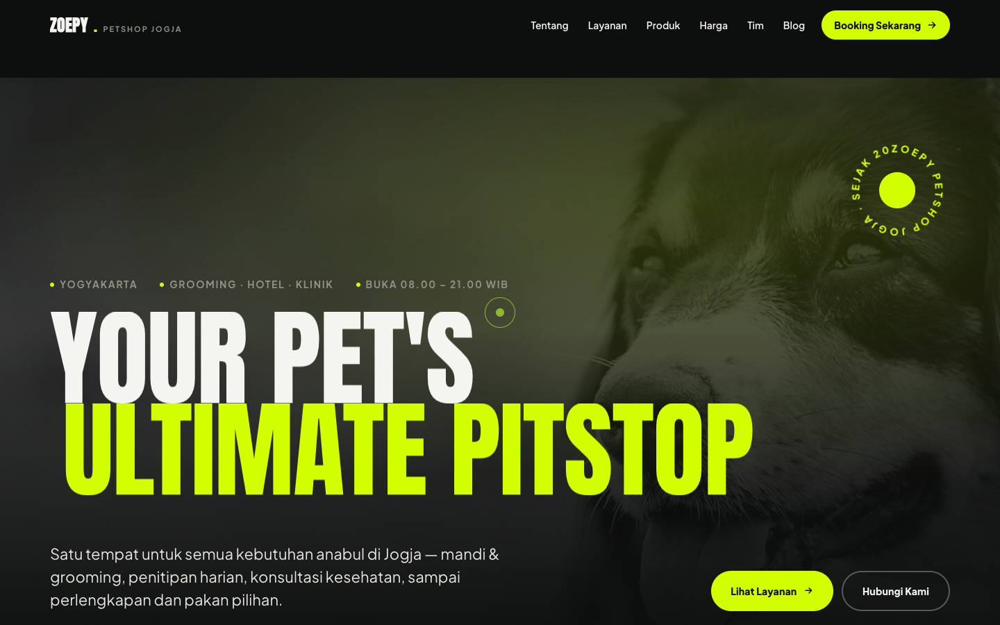
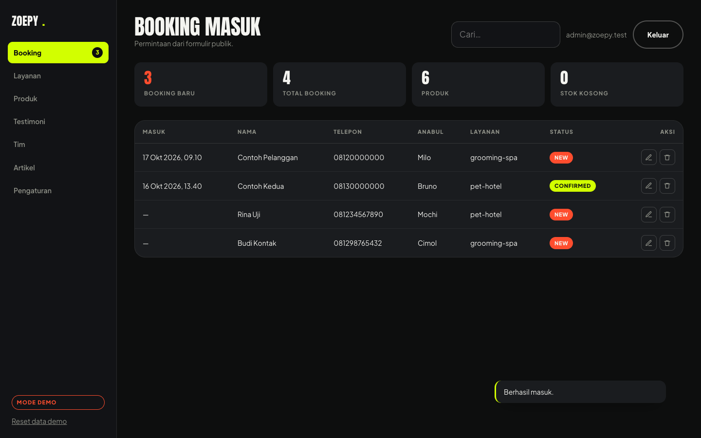
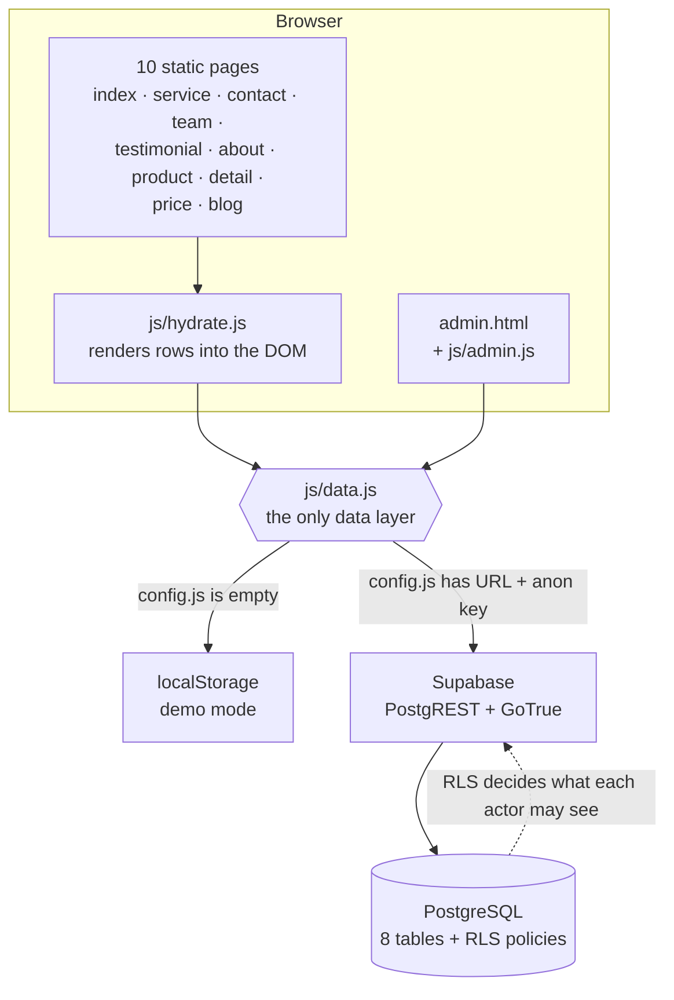
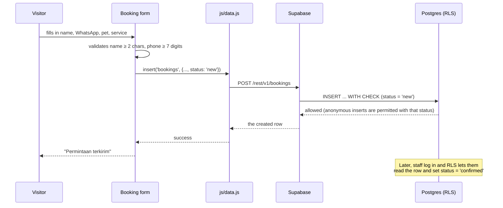

<div align="center">

# Zoepy Petshop Jogja

**High-energy editorial marketing site + Supabase-backed admin panel, for a real pet shop in Yogyakarta.**


</div>

### ▶ [Live demo](https://glen1599.github.io/zoepy-petshop-jogja/)

Runs in **demo mode** — no setup, no account. Try
[the site](https://glen1599.github.io/zoepy-petshop-jogja/index.html) and
[the admin panel](https://glen1599.github.io/zoepy-petshop-jogja/admin.html)
(log in with any email and password).

---

## Table of contents

- [Overview](#overview)
- [Screenshots](#screenshots)
- [Key features](#key-features)
- [The eleven pages](#the-eleven-pages)
- [Architecture](#architecture)
- [Two modes](#two-modes)
- [Data layer API](#data-layer-api)
- [Database schema](#database-schema)
- [Security model](#security-model)
- [Project structure](#project-structure)
- [Getting started](#getting-started)
- [Connecting Supabase](#connecting-supabase)
- [Testing the security model](#testing-the-security-model)
- [Deployment](#deployment)
- [Design system](#design-system)
- [Extending it](#extending-it)
- [Troubleshooting](#troubleshooting)
- [Roadmap](#roadmap)
- [Credits](#credits)

---

## Overview

A complete website for **Zoepy Petshop Jogja** — grooming, pet hotel, clinic and pet
supplies in Yogyakarta, Indonesia. It has two halves that share one data layer.

**The public site** is a kinetic, editorial marketing site. Most pet-shop sites look like a
templated directory; this one leans into oversized type, scroll-driven motion and a
high-contrast obsidian-and-acid-lime palette, because the shop's actual reputation is
built on looking after pets properly rather than looking cheap.

**The admin panel** is what makes it a real system instead of a brochure. Staff log in,
manage the content that appears on the public pages, and see booking requests submitted
through the site.

**One data layer, two backends.** Every list on the public site is rendered from a database
row. The same code reads from Supabase when it is configured, and from `localStorage` when
it is not — so the project runs (and can be reviewed) before any Supabase project exists,
and switches over by pasting two values.

**Who it is for:** the shop owner and staff, and anyone evaluating how the site is built.
The copy on the site is in Indonesian because that is the audience's language; the code,
comments, database and this document are in English.

## Screenshots

| Landing | Admin panel |
| --- | --- |
|  |  |

Both were captured running in demo mode against the seeded content.

---

## Key features

### Public site

**Motion** — built on Lenis (smooth scrolling) and GSAP ScrollTrigger:

| Effect | Where |
| --- | --- |
| Masked line reveal on the headline | Hero |
| Parallax on marked media | Hero background, about photo |
| Staggered section entrances (70 ms apart) | Every section |
| Marquee whose speed follows scroll velocity | Between hero and about |
| Pinned horizontal strip | "Sehari di Zoepy" gallery |
| 3D tilt on pointer move | Service tiles, plans, testimonials |
| Magnetic buttons | All primary CTAs |
| Custom cursor with a trailing ring | Whole site (fine pointers only) |
| Rotating SVG badge on a text path | Hero |
| Count-up statistics | About section |
| Outline headline that fills when scrolled into view | About section |

**Interaction**

- Drag-to-scroll product rail (pointer capture, not just native overflow).
- Before/after compare slider driven by pointer position 1:1, with arrow-key support and
  `role="slider"`.
- Booking form that writes to the database, with client-side validation.

**Accessibility**

- `prefers-reduced-motion: reduce` — all travel and springs collapse to short cross-fades;
  nothing is left invisible.
- `prefers-reduced-transparency: reduce` — the fixed nav becomes opaque instead of blurred.
- Skip link, visible focus rings, `aria-live` on the booking result, `aria-current` on the
  active nav item, `role="slider"` on the compare handle.
- **Content survives JavaScript failure.** Every page ships static markup; the data layer
  only *replaces* it when rows arrive. If a CDN is blocked or JS is off, the site still
  reads and the contact details are still there.

### Admin panel

- **Login** through Supabase Auth. There is no separate admin password to leak.
- **Schema-driven CRUD.** Rather than seven bespoke screens, one renderer reads a
  `RESOURCES` map and generates the table, the row actions and the modal form — including
  field types (`text`, `number`, `textarea`, `select`, `checkbox`, `datetime`, `tags`).
  Adding a table is one entry.
- **Booking queue** with a live count of new requests in the sidebar badge, plus free-text
  search.
- **Settings editor** for address, phone, email, hours, WhatsApp number and the pricing
  plans.
- **Demo reset** button, shown only in demo mode.

### Engineering

- **Idempotent SQL.** `schema.sql` and `seed.sql` can be run repeatedly; both were executed
  three times in a row with no change in row counts.
- **RLS verified, not assumed.** 24 assertions run against a real PostgreSQL 16 through a
  Supabase auth shim — see [Testing the security model](#testing-the-security-model).
- **Content-versionable plans.** Pricing lives as JSONB inside `site_settings`, so adding a
  package needs no migration.
- **Generator scripts** build the repeated page chrome from a single place, so ten pages
  cannot drift apart.

---

## The eleven pages

| Page | What it contains | Reads from |
| --- | --- | --- |
| `index.html` | Hero, marquee, bento services, pinned gallery, product rail, plans, team, testimonials, blog teasers, closing CTA | 8 hydration points |
| `service.html` | Four services, a four-step flow, booking form | `services` |
| `contact.html` | Contact cards, booking form, map embed, four FAQs | `site_settings` |
| `team.html` | Team grid, "three rules we do not negotiate" | `team_members` |
| `testimonial.html` | Customer quotes, "four things that keep coming up" | `testimonials` |
| `about.html` | The shop's story and four principles | static copy |
| `product.html` | Product catalogue grid | `products` |
| `detail.html` | One product, read from `?id=` or `?slug=`, plus three related | `products` |
| `price.html` | Three grooming packages, cost FAQs | `settings.plans` |
| `blog.html` | Article list | `posts` |
| `admin.html` | Login, CRUD, booking queue, settings | everything |

Every page carries the same navigation, footer and contact block, built by
`_build_pages.py` / `_build_pages2.py`.

---

## Architecture



The important property: **`js/data.js` is the only file that knows which backend is
active.** Pages and the admin panel call the same methods either way.

### Request flow for a booking



---

## Two modes

| Mode | When it activates | Where data lives | Who can log in |
| --- | --- | --- | --- |
| **demo** | `js/config.js` is empty | browser `localStorage` | any email + password |
| **supabase** | `js/config.js` has a URL and anon key | PostgreSQL, behind RLS | real Supabase Auth users |

Demo mode exists so the project can be run and judged without any setup — and so a missing
CDN or a Supabase outage degrades instead of breaking. Data is seeded from the same content
as `supabase/seed.sql`, so the site looks identical in both modes.

To reset demo data: the **Reset data demo** button at the bottom of the admin sidebar.

> **Read this before configuring.** `js/config.js` is committed to a public repository. The
> `anon` key is designed to be public and is safe there — the RLS policies are what protect
> the data. The **`service_role` key must never go in that file**: it bypasses every policy.

---

## Data layer API

`js/data.js` exposes `window.ZoepyDB`. Both backends implement the same surface.

| Method | Returns | Notes |
| --- | --- | --- |
| `mode` | `"supabase"` \| `"demo"` | String property, not a function |
| `isRemote` | `boolean` | Convenience for `mode === "supabase"` |
| `list(table, { onlyPublished })` | `Promise<Row[]>` | Ordered per table (see below) |
| `get(table, id)` | `Promise<Row \| null>` | |
| `insert(table, row)` | `Promise<Row>` | Demo mode assigns the next id |
| `update(table, id, patch)` | `Promise<Row>` | Partial patch |
| `remove(table, id)` | `Promise<true>` | |
| `settings()` | `Promise<Record<string, any>>` | `site_settings` as a flat object |
| `saveSetting(key, value)` | `Promise<true>` | Upsert on `key` |
| `resetDemo()` | `boolean` | Demo only; reseeds and returns `true` |
| `signIn(email, password)` | `Promise<User>` | Demo accepts anything non-empty |
| `signOut()` | `Promise<true>` | |
| `session()` | `Promise<User \| null>` | |

Default ordering per table: `sort_order` ascending for `services`, `products`,
`testimonials` and `team_members`; `published_at` descending for `posts`; `created_at`
descending for `bookings`.

Errors are thrown as `Error` with a prefixed message (for example
`Gagal membaca products: …`), so callers can surface them directly in a toast.

### Hydration

`js/hydrate.js` renders 13 datasets into elements marked with `data-hydrate`:

```
services · service-options · products · product-grid · product-detail
testimonials · team · posts · posts-page · contact · contact-cards
plans · meta
```

Each renderer returns early if its target is absent, which is why the same script is safe to
load on all eleven pages. If a fetch fails, the page keeps its static markup and the error
only goes to the console.

---

## Database schema

Eight tables. `bigint generated by default as identity` primary keys, `timestamptz`
timestamps, and `text[]` for tags.

| Table | Purpose | Notable columns |
| --- | --- | --- |
| `profiles` | One row per Supabase Auth user | `id` (FK → `auth.users`), `is_admin` |
| `services` | The four service tiles | `slug` (unique), `tags text[]`, `sort_order`, `published` |
| `products` | Shop catalogue | `price_idr`, `compare_idr`, `badge`, `in_stock`, `published` |
| `testimonials` | Customer quotes | `rating` (1–5), `author`, `location`, `published` |
| `team_members` | Staff grid | `name`, `role`, `photo_url`, `published` |
| `posts` | Blog articles | `slug` (unique), `excerpt`, `body`, `published_at`, `published` |
| `bookings` | Submitted requests | `status` ∈ `new·confirmed·done·cancelled`, `preferred_at`, `notes` |
| `site_settings` | Key/value store | `key` (PK), `value` JSONB — holds contact details and `plans` |

Guard rails that live in the schema rather than in application code:

- `bookings.status` is a `CHECK` constraint, so an invalid status cannot be written even by
  an admin using the API directly.
- `bookings` has length checks on `name`, `phone` and `notes`.
- `products.price_idr` and `compare_idr` cannot be negative.
- `testimonials.rating` is constrained to 1–5.
- `handle_new_user()` inserts a `profiles` row automatically when a user signs up, so
  `is_admin` always has somewhere to live.

---

## Security model

The whole security story is **Row Level Security in the database**. The frontend holds no
secrets and enforces nothing that matters.

```sql
-- The helper every policy leans on. SECURITY DEFINER so it can read `profiles`
-- without triggering that table's own policy (which would recurse).
create function public.is_admin() returns boolean
  language sql stable security definer set search_path = public, pg_temp
as $$
  select exists (select 1 from public.profiles where id = auth.uid() and is_admin = true);
$$;
```

| Actor | `services` / `products` / `testimonials` / `team_members` / `posts` | `bookings` | `profiles` | `site_settings` |
| --- | --- | --- | --- | --- |
| **anon** | `SELECT` where `published = true` | `INSERT` only, forced to `status = 'new'` | nothing | `SELECT` |
| **authenticated, not admin** | same as anon | nothing | own row | `SELECT` |
| **admin** | full CRUD | full CRUD | full CRUD | full CRUD |

Three details worth calling out:

1. **Anonymous visitors can create a booking but cannot set its status.** The policy is
   `with check (status = 'new')`, so a crafted request claiming `confirmed` is rejected by
   the database — not by client-side validation.
2. **Anonymous visitors cannot read bookings at all.** Phone numbers submitted through the
   form are not publicly queryable.
3. **`profiles` uses `is_admin()` rather than a subquery on itself**, which is what stops
   the classic infinite-recursion failure when a policy on a table references that table.

---

## Project structure

```
.
├── index.html                    landing page
├── service.html                  services detail + booking form
├── contact.html                  contact details, booking form, map, FAQ
├── team.html                     staff
├── testimonial.html              customer stories
├── about.html                    shop profile
├── product.html                  catalogue
├── detail.html                   single product (?id=)
├── price.html                    packages + cost FAQ
├── blog.html                     articles
├── admin.html                    admin panel shell
│
├── css/
│   ├── zoepy.css                 design system: tokens, layout, components, motion
│   ├── admin.css                 admin panel
│   ├── style.css                 retained Bootstrap template base
│   └── bootstrap.min.css         retained grid only
│
├── js/
│   ├── config.js                 ← Supabase credentials go here
│   ├── data.js                   data layer (Supabase | localStorage)
│   ├── hydrate.js                13 renderers for database rows
│   ├── admin.js                  schema-driven admin panel
│   ├── zoepy.js                  Lenis + GSAP motion layer
│   └── main.js                   retained template script
│
├── supabase/
│   ├── schema.sql                tables, indexes, triggers, RLS policies
│   ├── seed.sql                  initial content
│   ├── local_shim.sql            fake `auth` schema, for testing without Docker
│   ├── rls_test.sql              24 security assertions
│   └── README.md                 setup guide
│
├── docs/screenshots/             landing.png, admin.png
├── img/                          logo, photos, product shots (retained)
├── lib/                          Owl Carousel, easing, waypoints (retained)
│
├── _build_pages.py               generator: shared chrome + team + testimonial
├── _build_pages2.py              generator: about, product, detail, price, blog
├── README.md
└── LICENSE.txt
```

### Why the generator scripts exist

Ten pages share one navigation, one footer and one script list. Editing that by hand means
ten chances to diverge. `_build_pages.py` owns the chrome and exports `head()`, `nav()` and
`FOOTER`; `_build_pages2.py` imports them and adds only the page bodies.

```bash
python3 _build_pages.py    # regenerates team.html, testimonial.html
python3 _build_pages2.py   # regenerates about/product/detail/price/blog
```

`index.html`, `service.html` and `contact.html` are maintained directly — they are the three
pages with enough bespoke layout that generating them would cost more than it saves.

---

## Getting started

**The fastest way to look at it is the live demo:**
[glen1599.github.io/zoepy-petshop-jogja](https://glen1599.github.io/zoepy-petshop-jogja/)
— it deploys itself from `main` through GitHub Pages, so what you see is exactly what is in
this repository.

To run it locally: no build step, no package manager, no `npm install`. Any static file
server will do.

```bash
git clone https://github.com/glen1599/zoepy-petshop-jogja.git
cd zoepy-petshop-jogja
python3 -m http.server 8099
```

Then open **http://127.0.0.1:8099/index.html**.

To look at the admin panel, open **http://127.0.0.1:8099/admin.html** and log in with any
email and password — demo mode accepts anything.

> **`file://` will not work.** The Supabase client loads from a CDN and the data layer makes
> same-origin `fetch` calls; both need an HTTP origin.

`python3 -m http.server` is fine for development. For anything public, see
[Deployment](#deployment).

---

## Connecting Supabase

Full walkthrough with screenshots-in-words is in [`supabase/README.md`](supabase/README.md).
The short version:

**1 — Create a project.** [supabase.com](https://supabase.com) → New project. Note the
database password; you will not need it for this project, but you cannot recover it later.

**2 — Create the tables.** SQL Editor → New query → paste all of `supabase/schema.sql` →
**Run**. Then a new query with `supabase/seed.sql` → **Run**.

Both files are idempotent, so re-running them is safe if you are unsure whether they
finished.

**3 — Create the admin account.** Authentication → Users → **Add user**, enter an email and
password, and tick *Auto Confirm User*. Then run this, with your own email:

```sql
update public.profiles
   set is_admin = true
 where email = 'you@example.com';
```

Skipping this step is the most common reason someone can log in but nothing saves. The
account exists, but `is_admin()` returns `false`, so every write policy refuses.

**4 — Paste the credentials.** Project Settings → API → copy the **Project URL** and the
**anon public** key into `js/config.js`:

```js
window.ZOEPY_CONFIG = {
  supabaseUrl: "https://xxxxxxxxxxxx.supabase.co",
  supabaseAnonKey: "eyJhbGciOiJIUzI1NiIsInR5cCI6IkpXVCJ9...",
};
```

Reload `admin.html`. The badge in the bottom-left of the sidebar changes from **mode demo**
to **supabase**, and the sidebar's *Reset data demo* link disappears (it is demo-only).

**5 — Confirm the policies are live.** In an incognito window:

```
https://<your-project>.supabase.co/rest/v1/bookings?select=*
```

with the header `apikey: <your anon key>`. The correct answer is `[]`. If you see bookings
instead, the policies did not install — re-run step 2.

---

## Testing the security model

Claiming "RLS is configured" is worth very little. The policies in this repository were
executed against a real PostgreSQL 16, using `supabase/local_shim.sql` to emulate the parts
of Supabase that only exist on the platform:

- the `auth` schema and `auth.users` table,
- the `auth.uid()` function (fed here by a session setting instead of a JWT claim),
- the `anon` and `authenticated` roles, with Supabase's pattern of granting table access and
  letting RLS restrict it.

Because the roles and grants are reproduced faithfully, the tests exercise the same rules
that will run on Supabase — no Docker and no paid account needed.

```bash
brew install postgresql@16
export PATH="/opt/homebrew/opt/postgresql@16/bin:$PATH"

pg_ctl -D /opt/homebrew/var/postgresql@16 -l /tmp/pg.log start

psql -h 127.0.0.1 -d postgres -c "create database zoepy;"
psql -h 127.0.0.1 -d zoepy -f supabase/local_shim.sql
psql -h 127.0.0.1 -d zoepy -f supabase/schema.sql
psql -h 127.0.0.1 -d zoepy -f supabase/seed.sql
psql -h 127.0.0.1 -d zoepy -f supabase/rls_test.sql
```

Result, run three times in a row without recreating the database:

```
putaran 1 → PASS=24 FAIL=0
putaran 2 → PASS=24 FAIL=0
putaran 3 → PASS=24 FAIL=0
```

The suite begins by deleting its own fixtures, so it is safe to re-run.

### What the 24 assertions cover

| Actor | Asserted behaviour |
| --- | --- |
| `anon` | Sees the four published services, and **not** the unpublished one |
| `anon` | Sees products, testimonials, team members and site settings |
| `anon` | **Cannot** read bookings, and **cannot** read `profiles` |
| `anon` | **Can** submit a booking with `status = 'new'` |
| `anon` | **Cannot** submit a booking claiming `status = 'confirmed'` |
| `anon` | Cannot insert, update or delete services |
| `authenticated` (non-admin) | Is not an admin; cannot add services; cannot change product prices; cannot read bookings |
| `admin` | Is recognised by `is_admin()` |
| `admin` | Sees unpublished rows as well as published ones |
| `admin` | Can read bookings submitted anonymously |
| `admin` | Can insert, update and delete services |
| `admin` | Can move a booking to `confirmed` |

Two lessons learned while writing it, both of which are reflected in the file:

- **RLS does not raise an error on an `UPDATE`/`DELETE` with no matching policy.** It
  silently matches zero rows. The assertions therefore check the *outcome* (the row is
  unchanged) rather than expecting an exception.
- **A test that cannot be run twice is a trap**, because it will later "fail" and cast doubt
  on a system that is actually fine. Hence the self-cleanup at the top.

---

## Deployment

Any static host works — the site is plain files with no server-side rendering.

| Host | Notes |
| --- | --- |
| **Netlify** | Drag the folder into the dashboard, or connect the repo. No build command; publish directory is the project root. |
| **Vercel** | Import the repo, framework preset **Other**, no build command. |
| **Cloudflare Pages** | Connect the repo, leave the build command empty. |
| **GitHub Pages** | **Already active** for this repo — [live demo](https://glen1599.github.io/zoepy-petshop-jogja/). Serves `main` / root, with `.nojekyll` so files are served verbatim. |
| **Any web server** | Copy the folder. There is nothing to compile. |

Two things to check after deploying:

1. Serve over **HTTPS**. `getUserMedia` (for a future camera feature) and some browser APIs
   require a secure context, and Supabase Auth redirects behave better over TLS.
2. Add your production domain to Supabase → Authentication → URL configuration, so auth
   redirects do not bounce to localhost.

Because the anon key is public by design, deploying does not require any secret injection —
which is exactly why the RLS policies had to be right.

---

## Design system

All tokens live at the top of `css/zoepy.css`.

| Token | Value | Used for |
| --- | --- | --- |
| `--obsidian` | `#0d0e0e` | Page ground |
| `--obsidian-2` | `#121316` | Alternating sections, footer |
| `--obsidian-3` | `#1a1c1f` | Cards, tiles, inputs |
| `--acid` | `#d2ff00` | The one accent: CTAs, marquee, focus |
| `--coral` | `#ff4d2e` | Secondary accent, closing CTA |
| `--bone` | `#f4f4f0` | Light sections, text on dark |
| `--display` | Anton | Headlines |
| `--body` | Plus Jakarta Sans | Everything else |

Two type families, one accent colour, and surfaces separated by a step in tone rather than
by borders. Fluid type and spacing use `clamp()`, so a larger user font size scales the
layout instead of breaking it.

Key component classes: `.shell` (page gutters) · `.section` · `.display` · `.marquee` ·
`.bento` / `.tile` · `.product` / `.product-grid` · `.plan` · `.crew__card` · `.quote` ·
`.post` · `.booking` · `.faq__item` · `.steps` / `.step` · `.nav__cta`.

---

## Extending it

### Adding a table (worked example)

Say you want customer reviews with a star rating and a "verified purchase" flag.

**1 — Add it to `supabase/schema.sql`** and re-run that file:

```sql
create table if not exists public.reviews (
  id          bigint generated by default as identity primary key,
  author      text not null,
  rating      int  not null check (rating between 1 and 5),
  body        text,
  verified    boolean not null default false,
  published   boolean not null default true,
  created_at  timestamptz not null default now()
);

alter table public.reviews enable row level security;

create policy "reviews: public reads published" on public.reviews
  for select using (published = true or public.is_admin());
create policy "reviews: admin inserts" on public.reviews
  for insert with check (public.is_admin());
create policy "reviews: admin updates" on public.reviews
  for update using (public.is_admin()) with check (public.is_admin());
create policy "reviews: admin deletes" on public.reviews
  for delete using (public.is_admin());
```

**2 — Add one entry to `RESOURCES` in `js/admin.js`.** The list, the modal form and the
field validation are generated from this:

```js
reviews: {
  label: "Ulasan",
  table: "reviews",
  title: "Ulasan pelanggan",
  sub: "Tampil di halaman depan.",
  searchKeys: ["author", "body"],
  columns: [
    { key: "author", label: "Nama" },
    { key: "rating", label: "Bintang" },
    { key: "published", label: "Tampil", render: (v) =>
        `<span class="pill pill--${v ? "yes" : "no"}">${v ? "ya" : "tidak"}</span>` },
  ],
  fields: [
    { key: "author",   label: "Nama",    type: "text",   required: true },
    { key: "rating",   label: "Bintang", type: "number" },
    { key: "body",     label: "Isi",     type: "textarea" },
    { key: "verified", label: "Terverifikasi", type: "checkbox" },
    { key: "published", label: "Tampilkan",    type: "checkbox" },
  ],
},
```

**3 — Add a renderer in `js/hydrate.js`** if you want it on a public page, targeting
`[data-hydrate="reviews"]`.

No CRUD code was written in any of those three steps.

### Adding a page

Add the body to `_build_pages2.py` and re-run it — you get the nav, footer, fonts and script
list for free.

### Changing the look

Everything visual is a token in `css/zoepy.css`. Changing `--acid` recolours every CTA,
the marquee and the focus rings at once.

---

## Troubleshooting

| Symptom | Cause and fix |
| --- | --- |
| Admin logs in but nothing saves | The account exists but `is_admin` is `false`. Run the `update public.profiles …` statement from step 3. |
| Badge still says **mode demo** | `js/config.js` is empty, or the browser cached the old file. Hard-reload (`Cmd/Ctrl + Shift + R`). |
| `GET /rest/v1/bookings` returns rows in incognito | The policies did not install. Re-run `supabase/schema.sql` and check the SQL Editor reported no errors. |
| Data looks unchanged after editing in admin | You are in demo mode: edits live in `localStorage` on that browser only. |
| Page is blank | JavaScript failed. Open the console. The static markup should still be visible — if it is not, that is a bug worth reporting. |
| `file://` shows a blank or broken page | Expected. Serve over HTTP. |
| Nav overlaps content on a sub-page | The fixed nav needs `body.page`. Regenerate the page with the build script rather than hand-editing. |
| `pg_ctl` cannot start PostgreSQL | Another server holds port 5432, or the data directory was initialised by a different version. Check `/tmp/pg.log`. |

---

## Roadmap

- [ ] Image uploads to Supabase Storage instead of pasted URLs
- [ ] Row-level auditing for the booking table (who changed a status, and when)
- [ ] Email or WhatsApp notification when a booking arrives
- [ ] Bahasa Indonesia number and date formatting for the admin table
- [ ] `supabase db push` migration workflow once the schema stabilises
- [ ] Playwright coverage for the booking flow

---

## Credits

- **Application code, design system, content, motion layer, data layer, admin panel and the
  Supabase schema** — Glen Devit Renaldi.
- **Base HTML/CSS scaffolding** — the free *Pet Shop* template by
  [HTML Codex](https://htmlcodex.com/pet-shop-website-template), retained under
  [`LICENSE.txt`](LICENSE.txt). The Bootstrap grid, Owl Carousel and icon font come from
  that template; the design system sits on top of them rather than replacing them.
- **Libraries** — [GSAP](https://gsap.com/) and
  [Lenis](https://github.com/darkroomengineering/lenis) via CDN,
  [Supabase JS](https://supabase.com/docs/reference/javascript/introduction).

## License

Application code: MIT. The retained template scaffolding remains under the HTML Codex
license in [`LICENSE.txt`](LICENSE.txt).

## Author

**Glen Devit Renaldi** — [@glen1599](https://github.com/glen1599)
